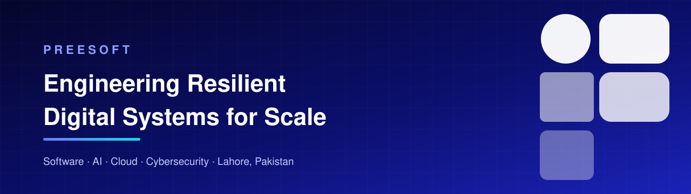

 

## About Preesoft

We design, build and run mission-critical software platforms for businesses across industries and regions.
Our systems are built to support real operations for the long term, not just quick launches.

| 8+ | 25+ | 100+ | 8+ |
|:--:|:--:|:--:|:--:|
| Years of experience | Platform engagements | Engineers | Global regions |

## What we do

| Area | Services |
|------|----------|
| **Engineering & Platforms** | AI & Machine Learning · Custom Software · Enterprise Web & Mobile · SaaS Architecture · Cloud & DevOps |
| **Security & Strategy** | Cybersecurity · Strategic IT Consulting |
| **Engineering Delivery** | Dedicated Engineering Teams · Staff Augmentation |
| **Product & Experience** | UI/UX Design · Game Development |
| **Growth** | Digital Marketing |

## Our tech stack

## Our products

| Product | What it does | Industry |
|---------|--------------|----------|
| **SmartPOS** | AI-powered retail point of sale | Retail & Commerce |
| **IntelliSchool** | School management system | Education |
| **Order Intelligence AI (Bookify OBM)** | Order capture and ERP sync for field sales teams | Distribution & Sales |

## Industries we serve

Construction & Infrastructure · Healthcare & Wellness · Telecom, GIS & Field Operations · Transportation & Logistics · Sales Enablement · Retail & E-Commerce · Education & E-Learning · Enterprise SaaS

## Our work on GitHub

We maintain **400+ repositories** across web, mobile, AI and backend systems. Almost all are **private**, built for our clients, and we keep client work confidential.
A few tools we share publicly:

| Repository | Description | Language |
|------------|-------------|----------|
| [**cve-scanner**](https://github.com/preesoftdev/cve-scanner) | Security scanner that checks software for known CVE flaws |  |
| [**whatwealldo-events-service**](https://github.com/preesoftdev/whatwealldo-events-service) | Events service backend |  |

## How we work

1. **Strategic alignment and architecture audit**
2. **Solution design and risk reduction**
3. **Agile engineering and system integration**
4. **Rigorous QA and phased deployment**
5. **Continuous optimization and SLA management**

## Where we are

- **Head office:** 163 Block F, Johar Town, Lahore, Pakistan
- **Clients in:** Canada · UK · USA · Germany · South Africa · Malaysia

## Let's build something

Have a project in mind? Talk to us.

- Email: [info@preesoft.com](mailto:info@preesoft.com)
- Phone: +92 42 37840398
- Website: [preesoft.com](https://preesoft.com/)
- Careers: see the Careers page on our website

Preesoft · Engineering Resilient Digital Systems for Scale

